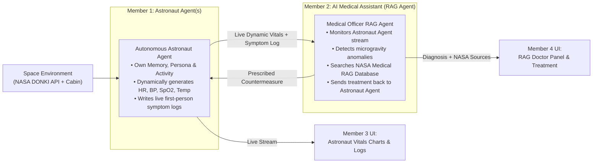

# 🚀 A.R.E.S. Med — Multi-Agent Space Health Monitoring System

**2026 NASA Space Apps Challenge:** [Create Health Monitoring Software for Astronauts on Space Missions](https://www.spaceappschallenge.org/2026/challenges/health-monitoring-software/?tab=resources)  
**Hackathon Dates:** November 14–15, 2026  

---

## 🎯 What We Are Building (In Plain English)

On deep-space missions to the Moon or Mars, radio signals take up to **20 minutes each way** to reach Earth, so astronauts cannot rely on real-time human doctors in Houston.

We are building a **Multi-Agent AI System + Web Dashboard**:
1. **Autonomous Astronaut Agent(s) *(Member 1)*:** AI/model agents that simulate living astronauts in space—dynamically generating non-hardcoded health vitals (`Heart Rate`, `Blood Pressure`, `SpO2`, `Body Temp`, `HRV`) and first-person symptom logs based on their current activity, internal physiology, and real NASA space weather (`DONKI API`).
2. **AI Medical Assistant — RAG Agent *(Member 2)*:** An autonomous medical officer agent that monitors the Astronaut Agent's live stream, detects anomalies against microgravity baselines, searches our **NASA Space Medicine RAG Knowledge Base**, and prescribes step-by-step treatments back to the Astronaut Agent.
3. **Mission Medical Dashboard *(Members 3 & 4)*:** A live web interface showing the Astronaut Agent's streaming vitals & logs on the left/center, and the RAG Medical Assistant's clinical analysis & treatment actions on the right.

---

## 🤖 System Flow Diagram

---

## 👥 Team Guides (Open Your Guide!)

Each member has a **1-page guide** explaining exactly what to build:

| Team Member | Role | Guide Link |
| :--- | :--- | :--- |
| **Member 1** | **Autonomous Astronaut Agent(s)** *(Dynamic Vitals & Symptom Generator)* | 👉 **[team-guides/MEMBER-1-GUIDE.md](./team-guides/MEMBER-1-GUIDE.md)** |
| **Member 2** | **AI Medical Assistant (RAG Agent)** *(Anomaly Detection & NASA RAG Lookup)* | 👉 **[team-guides/MEMBER-2-GUIDE.md](./team-guides/MEMBER-2-GUIDE.md)** |
| **Member 3** | **Frontend — Astronaut View** *(Live Vitals Charts, Agent Feed & Environment Controls)* | 👉 **[team-guides/MEMBER-3-GUIDE.md](./team-guides/MEMBER-3-GUIDE.md)** |
| **Member 4** | **Frontend — RAG Doctor View & Pitch** *(Diagnosis Panel, Treatment Action & Demo Video)* | 👉 **[team-guides/MEMBER-4-GUIDE.md](./team-guides/MEMBER-4-GUIDE.md)** |

---

## 📂 NASA Reference Data (`data/` Folder)

All the NASA space medicine research, microgravity baselines, and treatment protocols are ready in the [`data/`](./data/) folder for Member 1's Astronaut Agent and Member 2's RAG Knowledge Base:

- [`data/nasa_space_medicine_research.md`](./data/nasa_space_medicine_research.md) — Full NASA Space Medicine research document (for RAG ingestion).
- [`data/nasa_baselines_and_thresholds.json`](./data/nasa_baselines_and_thresholds.json) — Earth ($1g$) vs. Microgravity ($\mu g$) physiological baselines and activity ranges.
- [`data/rag_protocols_8_scenarios.json`](./data/rag_protocols_8_scenarios.json) — Structured NASA medical protocols, `CHeCS` medications, contraindications, and physiological trends for 8 spaceflight anomalies.
