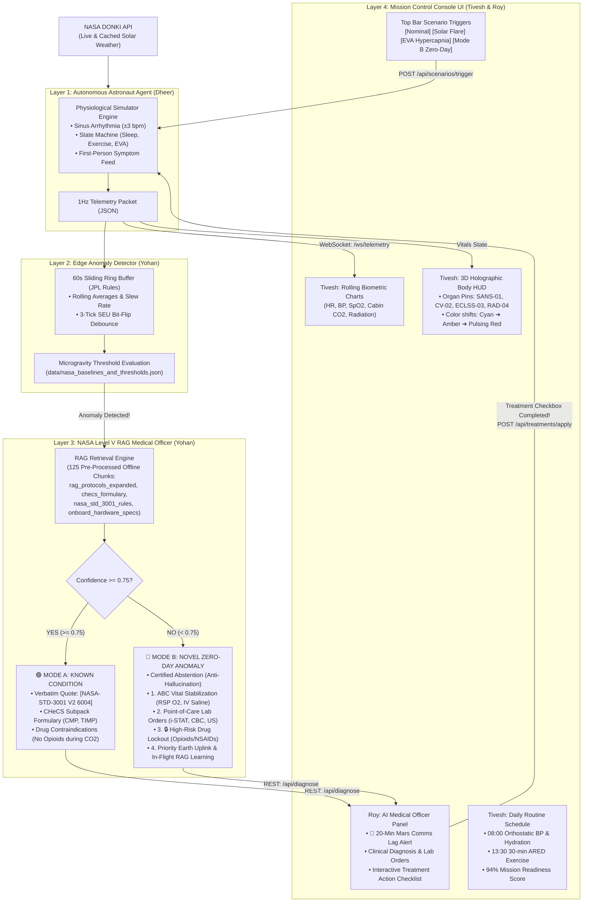

# 🚀 A.R.E.S. Med — Autonomous Space Health Monitoring System

**2026 NASA Space Apps Challenge:** [Create Health Monitoring Software for Astronauts on Space Missions](https://www.spaceappschallenge.org/2026/challenges/health-monitoring-software/?tab=resources)  
**Hackathon Dates:** November 14–15, 2026  
**Local Event Location:** Mauritius  

---

## 🎯 What We Are Building (In Plain English)

On deep-space missions to the Moon or Mars, radio communication suffers a **20-minute one-way delay** to Earth. During an acute life-support crisis or solar radiation storm, astronauts cannot wait 40 minutes for flight surgeons in Houston—they need an autonomous, onboard, 100% offline medical monitoring and triage console.

**A.R.E.S. Med** (*Astronaut Rapid Evaluation Support & Medical System*) is a **Closed-Loop Multi-Agent Simulation & Clinical Decision Support System**:

1. **Autonomous Astronaut Agent (Digital Twin) — *Dheer*:** Generates dynamic, non-hardcoded microgravity vitals (`HR`, `BP`, `SpO2`, `HRV`, `Core Temp`), activity states (`SLEEP`, `RESTING`, `EXERCISE`, `EVA`), and first-person symptom logs, modulated by live NASA space weather (`DONKI API`).
2. **60-Second Sliding Ring Buffer & SEU Filter — *Yohan*:** Evaluates incoming telemetry against spaceflight-adapted baselines using JPL Power-of-Ten safety rules and a 3-tick persistence debounce to filter cosmic ray bit-flips.
3. **NASA Level V RAG Medical Officer — *Yohan*:** An onboard AI doctor executing our strict **2-Mode Clinical Protocol**:
   - **Mode A (Known Condition $\ge 75\%$):** Matches project scenarios and displays a verified NASA requirement only when one is mapped. Clinical steps, medication entries and lockouts are unverified project simulation content.
   - **Mode B (Novel Zero-Day Anomaly $< 75\%$):** Triggers **Certified Abstention** (no hallucinations) + 4-step stabilization (ABC vitals, Point-of-Care `i-STAT`/`C2M2` labs, High-Risk Drug Lockout, In-Flight Learning).
4. **Mission Control Console & 3D Body HUD — *Tivesh*:** A dark-mode HTML/CSS/JS dashboard featuring real-time `Chart.js` line graphs, an interactive **3D Holographic Anatomical Body HUD** with glowing organ pins (`SANS-01`, `CV-02`, `ECLSS-03`, `RAD-04`), and a **Daily Routine Prevention Schedule** (`94% Readiness Meter`).
5. **System Integrator & Pitch Lead — *Roy*:** Connects the closed-loop recovery (applying treatments heals astronaut vitals back to normal tick-by-tick) and leads the **Official 7-Slide Deck** and **4-Minute Timed Presentation**.

---

## 🔄 Updated System Flow Diagram



---

## 👥 Team Roles & Dedicated Guides

Each member has a dedicated, self-contained guide with their tasks, data files, artifacts, and AI master prompts:

| Team Member | Role | Primary AI Tool | Guide Link |
| :--- | :--- | :--- | :--- |
| **Dheer** | **Autonomous Astronaut Agent** *(Physiological Simulator & Space Weather)* | Antigravity (Gemini Pro) | 👉 **[`team-guides/DHEER-GUIDE.md`](./team-guides/DHEER-GUIDE.md)** |
| **Yohan** | **Whole RAG System** *(Anomaly Detector & Level V AI Medical Officer)* | Antigravity (Gemini Pro) | 👉 **[`team-guides/YOHAN-GUIDE.md`](./team-guides/YOHAN-GUIDE.md)** |
| **Tivesh** | **Frontend Entirely** *(Mission Control Console, 3D Body HUD & Charts)* | ChatGPT Plus / Claude | 👉 **[`team-guides/TIVESH-GUIDE.md`](./team-guides/TIVESH-GUIDE.md)** |
| **Roy** | **Jack of All Trades** *(Integration, Backend/AI Assistant & Pitch Lead)* | DeepSeek / ChatGPT Plus | 👉 **[`team-guides/ROY-GUIDE.md`](./team-guides/ROY-GUIDE.md)** |

---

## 🛰️ Hybrid Dataset Strategy (Room for Improvement)

NASA's official private challenge dataset is expected to be released within ~24 hours of kickoff. Our architecture is designed with **zero-friction dataset swappability**:
1. **Priority #1 (Official NASA Challenge Dataset):** When the official CSV/JSON dataset arrives, place it in `data/nasa_official_dataset/`. Dheer's simulator and Yohan's anomaly detector load this as the primary baseline.
2. **Priority #2 (Our Synthetic Digital Twin Fallback):** If NASA's dataset lacks continuous 1Hz streams or specific crisis states, our mathematical physiological engine fills in the missing biometric parameters automatically.

---

## ⏰ Critical Timeline (Mauritius Local Time)

* **Saturday, Nov 14 — 09:00:** NASA submission portal opens.
* **Saturday, Nov 14 — 21:00:** Golden Loop verified (Crisis $\rightarrow$ Anomaly $\rightarrow$ RAG Treatment $\rightarrow$ Astronaut Recovers).
* **Sunday, Nov 15 — 10:00:** **Code Freeze.** Bug fixes only.
* **Sunday, Nov 15 — 10:30:** Roy records backup 60-second demo video on USB.
* **Sunday, Nov 15 — 11:30 (HARD LOCAL DEADLINE):** Project, 7-slide deck, and video submitted!
* **Sunday, Nov 15 — 12:00:** Live judging begins! (Strictly **4-minute presentation** + 2-minute Q&A).

---

## 📂 Repository Directory Tree

```
├── artifacts/
│   ├── clinical_decision_protocol_2_modes.md   <-- Mode A vs Mode B clinical spec
│   ├── official_hackathon_submission_rules.md  <-- Mauritius presentation rules & slide structure
│   ├── security_and_safety_guardrails.md       <-- JPL Power-of-Ten & anti-hallucination rules
│   ├── system_mechanics_deep_dive.md           <-- Physiological equations & fluid shift math
│   └── vanilla_frontend_architecture.md        <-- Shared DOM IDs, layout specs & API endpoints
├── data/
│   ├── nasa_baselines_and_thresholds.json      <-- Shared Layer 1/2/4 baselines, cosinor, fluid-shift, DONKI/SRAG & recovery curves
│   ├── simulation_scenario_seeds.json          <-- Dheer's 24 scenario seeds + 6 crisis trajectories + 21 symptom logs + PhysioNet/OSDR manifests
│   ├── lab_reference_intervals.json            <-- Specimen-aware i-STAT CG8+/CG4+ & CBC warning/critical bands
│   ├── rag_protocols_expanded.json             <-- Yohan's 8 legacy scenarios + 32 NASA CPGs (CPG-01..32)
│   ├── checs_formulary.json                    <-- 54 pre-processed ISS CHeCS meds & lockouts
│   ├── nasa_std_3001_rules.json                <-- Source-traced requirements and SMAC limits
│   ├── onboard_hardware_specs.json             <-- 5 onboard diagnostic device specs (i-STAT, Ultrasound-2, C2M2, OCT, Tempus Pro)
│   ├── rag_protocols_8_scenarios.json          <-- Original 8 scenarios (preserved for compatibility)
│   ├── nasa_space_medicine_research.md         <-- Space medicine notes & CHeCS formulary
│   └── arxiv_literature_citations.json         <-- Academic literature citations for judging
├── team-guides/
│   ├── DHEER-GUIDE.md                          <-- Autonomous Astronaut Agent Guide
│   ├── YOHAN-GUIDE.md                          <-- Whole RAG System & AI Medical Officer Guide
│   ├── TIVESH-GUIDE.md                         <-- Complete Frontend & 3D Body HUD Guide
│   └── ROY-GUIDE.md                            <-- Integration, Testing & Pitch Lead Guide
└── README.md                                   <-- This master documentation file
```
