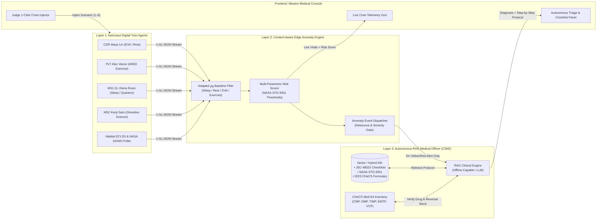

# NASA Space Apps 2026 — Master Engineering & Hackathon Plan
**Target Challenge:** Create Health Monitoring Software for Astronauts on Space Missions  
**Hackathon Start Date:** November 14, 2026  

> [!TIP]
> **Why Planning Now Wins Hackathons:** Most student teams waste the first 12–16 hours of a 48-hour hackathon arguing about what to build, designing APIs on the fly, and fixing merge conflicts. By locking in your **Architecture**, **JSON Data Contracts**, **RAG Document Schemas**, and **UI Layout** before November 14, your team can start coding independently at Minute 1.

---

## 1. End-to-End System Architecture



---

## 2. Locked-In JSON Data Contracts (The Key to Parallel Teamwork)

If you agree on these **3 JSON schemas** now, the Frontend team and Backend/AI team can build simultaneously without waiting on each other.

### Contract A: Layer 1 $\rightarrow$ Layer 2 (Telemetry Tick — Every 1 Second)
```json
{
  "timestamp": "2026-11-14T14:22:05Z",
  "mission_day": 84,
  "comms_status": {
    "one_way_delay_sec": 1120,
    "mode": "AUTONOMOUS_LEVEL_V",
    "solar_conjunction_blackout": false
  },
  "environment": {
    "cabin_ppCO2_mmHg": 3.8,
    "cabin_ppO2_mmHg": 148.0,
    "cabin_pressure_kPa": 101.3,
    "cabin_temp_C": 22.4,
    "donki_spe_active": false,
    "dosimetry_rate_mSv_hr": 0.054
  },
  "astronaut": {
    "id": "AST-01",
    "name": "CDR Maya Lin",
    "activity_state": "IVA_REST",
    "active_scenario_id": "SCENARIO_1_HYPERCAPNIA",
    "vitals": {
      "hr_bpm": 88.2,
      "sbp_mmHg": 124.5,
      "dbp_mmHg": 76.1,
      "spo2_pct": 97.0,
      "hrv_rmssd_ms": 21.4,
      "cbt_C": 37.9,
      "rr_bpm": 19.8,
      "ve_L_min": 14.2
    },
    "specialized_diagnostics": {
      "oct_rnfl_um": 98.0,
      "refraction_shift_D": 0.0,
      "alc_cells_uL": 2050,
      "ultrasound_ijv_thrombus": false,
      "bladder_volume_mL": 210
    },
    "symptom_log": "Throbbing frontal headache, mild facial flushing, difficulty concentrating on glovebox procedure."
  }
}
```

### Contract B: Layer 2 $\rightarrow$ Frontend & Layer 3 (Anomaly Assessment)
```json
{
  "astronaut_id": "AST-01",
  "alert_level": "WARNING_YELLOW",
  "risk_score_0_100": 68,
  "context_evaluated": "IVA_REST (Adapted Microgravity Baseline)",
  "breached_parameters": [
    {
      "parameter": "cabin_ppCO2_mmHg",
      "value": 3.8,
      "threshold": 3.0,
      "standard_ref": "NASA-STD-3001 [V2 6004]"
    },
    {
      "parameter": "hr_bpm",
      "value": 88.2,
      "expected_ug_range": "52-68 bpm",
      "standard_ref": "NASA-STD-3001 [V1 3003a]"
    }
  ],
  "trigger_rag_consultation": true
}
```

### Contract C: Layer 3 (RAG Assistant) $\rightarrow$ Frontend (Clinical Action Plan)
```json
{
  "diagnosis_title": "Acute Cabin Hypercapnia (CO2 Toxicity) — ECLSS Scrubbing Lag",
  "confidence": 0.94,
  "nasa_citations": [
    "NASA-STD-3001 Vol 2 Rev D [V2 6004]",
    "OCHMO-TB-004 (Carbon Dioxide)",
    "ISS Medical Checklist JSC-48522 Sec 4.2"
  ],
  "clinical_reasoning": "Crewmember exhibits elevated HR (88 bpm vs 52-68 bpm μg rest baseline), suppressed HRV (21.4 ms), and tachypnea (19.8 bpm) correlated with cabin ppCO2 of 3.8 mmHg (>3.0 mmHg 1-hr limit) and frontal headache.",
  "checs_medications": [
    {
      "drug": "Ibuprofen 400-600 mg PO (or Acetaminophen 325-650 mg PO)",
      "pack": "Convenience Medications Pack (CMP)",
      "contraindication_warning": "STRICT CONTRAINDICATION: Do NOT administer opioids (Hydrocodone/Hydromorphone) — suppresses central respiratory drive and worsens CO2 retention."
    }
  ],
  "hardware_and_diagnostics": [
    "Medical Diagnostics Pack (MDP): i-STAT / PCBA venous blood gas if ppCO2 > 5.0 mmHg",
    "Respiratory Support Pack (RSP): 100% O2 demand mask standby"
  ],
  "autonomous_checklist": [
    { "step": 1, "action": "Relocate CDR Lin out of low-ventilation compartment immediately.", "completed": false },
    { "step": 2, "action": "Deploy portable inter-module ventilation fan and run CDRA 4BMS zeolite / CAMRAS diagnostics.", "completed": false },
    { "step": 3, "action": "Administer Ibuprofen 400 mg PO from CMP for frontal headache.", "completed": false },
    { "step": 4, "action": "Suspend scheduled 75% VO2max ARED exercise and shift crew diet RQ to 0.85 (-20% CO2 load).", "completed": false }
  ]
}
```

---

## 3. Scope Reduction for a 48-Hour Hackathon (The "Golden Rule")

Your research covers **8 scenarios**. Implementing all 8 with equal depth is great for the RAG database, **but for the live interactive UI demo**, focus your polish on **4 Showcase Scenarios** that look visually distinct on charts:

1. **Scenario 1: Hypercapnia ($\text{CO}_2$ Scrubbing Fault)** — Best example of **Cabin Environment + Vitals + Contraindication Alert** (no opioids!).
2. **Scenario 4: Solar Particle Event (Acute Radiation Syndrome)** — Best example of **Live NASA DONKI API Integration + Weibull Dosimetry Surge + Storm Shelter Triage**.
3. **Scenario 5: EVA Thermal Strain ("Space Fever") & Decompression Sickness** — Best example of **Microgravity Physics** (lack of convection driving $CBT > 40^\circ\text{C}$ and $\text{SpO}_2$ drop).
4. **Scenario 2 or 7: SANS (Neuro-Ocular) or IJV Thrombosis** — Best example of **Unique Zero-G Pathology** (cephalad fluid shift, OCT RNFL thickening / ultrasound clot + Vascular Contingency Pack).

*(Still include all 8 scenarios as Markdown files in your RAG Knowledge Base so the AI can answer questions about any of them!)*

---

## 4. What Your Team Should Do Between Now and November 14

Under hackathon fairness rules, you shouldn't write the production application code before the start date, **but you CAN and SHOULD do the following prep work**:

### Week 1 (Oct 30 – Nov 5): Architecture & Knowledge Base Curation
- [ ] **Get your NASA API Key:** Register a free key at `https://api.nasa.gov/` so you aren't rate-limited on `DEMO_KEY` when calling `/DONKI/SEP` and `/DONKI/FLR`.
- [ ] **Prepare the 8 RAG Protocol Documents:** Organize the 8 scenarios and baseline tables from [nasa_space_medicine_reference.md](file:///C:/Users/tupla/.gemini/antigravity/brain/a111fa97-aa4f-4386-93c9-303d0dc24d55/nasa_space_medicine_reference.md) into clean study notes so you can drop them straight into your RAG folder on Day 1.
- [ ] **Decide & Install Your Tech Stack Locally:** Every teammate must have the exact same versions of Node.js, Python, Git, and IDE extensions installed and tested on their laptop *before* Nov 14.

### Week 2 (Nov 6 – Nov 13): Wireframes, Mock Practice & Pitch Storyboard
- [ ] **Draw the UI Wireframe (Figma or Excalidraw):** Design the single-screen **Mission Medical Console** so the frontend team doesn't waste time guessing colors or layout.
- [ ] **Do a 2-Hour "Hello World" Practice Run:** Have the team practice connecting a simple Python FastAPI endpoint (or Node server) to a React chart and a basic RAG query on dummy data, then delete the practice repo. This eliminates 90% of "first-hackathon setup bugs."
- [ ] **Draft the 30-Second / 2-Minute Video Script:** Know the exact story you will tell judges (*"Meet Commander Lin, 18 light-minutes from Earth..."*).

---

## 5. Discussion Questions to Finalize Your Plan

To lock down the next layer of your planning, let's decide:
1. **Team Size & Skills:** How many teammates do you have, and what languages/frameworks is everyone most comfortable with?
2. **RAG Architecture Choice:** Do you want to use an **API-based LLM** (like Gemini API with local vector search) plus a **100% offline deterministic fallback** (so your demo works even if hackathon Wi-Fi dies)?
3. **UI Layout:** Would you like to design the exact screen-by-screen UI wireframe and user flow next?
