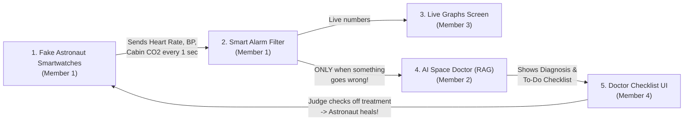

# 👋 START HERE: The Simple 3-Minute Team Guide

If the NASA medical research looks long or intimidating—**don't worry!** You do **not** need to memorize space medicine to build this app. All the math and medical data are already saved in the [`data/`](../data/) JSON files for you to copy-paste.

This page explains **what we are building in plain English** so everyone on our 4-person team is 100% on the same page.

---

## 🎯 What Are We Building in 1 Sentence?

We are building a **smart smartwatch + AI doctor dashboard for astronauts on the way to Mars**, because when an astronaut gets sick near Mars, **radio signals take 20 minutes to reach Earth**, so they can't wait for a human doctor in Houston.

---

## 🧩 How the App Works (In 4 Simple Steps)

### Step 1: Simulated Astronauts (Member 1)
Since we don't have real astronauts in space right now, **Member 1** writes a Python loop that pretends to be **4 astronauts** wearing smartwatches inside a spaceship. Every 1 second, it outputs their Heart Rate, Blood Pressure, Oxygen, Body Temperature, and the spaceship's $\text{CO}_2$ and Radiation levels.

### Step 2: The "Space vs. Earth" Smart Alarm (Member 1)
In zero-gravity, human bodies change! For example:
- Normal resting heart rate drops lower than on Earth (`52–68 bpm`).
- Normal resting body temperature rises by $+1^\circ\text{C}$ (`37.8 °C`, called *"Space Fever"*).
- Also, if an astronaut has a heart rate of `155 bpm` while **Exercising**, that's **Normal (Green)**! Put if their heart rate is `90 bpm` while **Resting** and cabin $\text{CO}_2$ is high, that's **Danger (Yellow/Red)**!
**Member 1's** code checks a simple JSON table (`data/nasa_baselines_and_thresholds.json`) to decide if the astronaut is **Green (Safe)**, **Yellow (Warning)**, or **Red (Critical)**.

### Step 3: The AI Space Doctor — RAG (Member 2)
When an astronaut turns **Yellow** or **Red**, **Member 2's** code wakes up.
It searches our NASA medical cheat-sheet (`data/rag_protocols_8_scenarios.json`) and returns:
1. **What is wrong** (e.g., *"CO2 Poisoning from a broken air scrubber"*).
2. **Which NASA medicine kit to open** (e.g., *"Give Ibuprofen 400mg from the Convenience Med Pack"*).
3. **Safety Warning** (e.g., *"DO NOT give Opioid painkillers—it will slow their breathing!"*).
4. **4-Step To-Do Checklist** to fix the problem.

### Step 4: The Mission Control Screen (Members 3 & 4)
- **Member 3** builds the **Left & Center of the screen**: the 4 astronaut profile cards, the live moving line charts, and the **"Inject Emergency"** buttons at the top so the judges can trigger a crisis with 1 click.
- **Member 4** builds the **Right side of the screen**: the AI Doctor's diagnosis box and the clickable **To-Do Checklist**. When the judge clicks the checkboxes on Member 4's checklist, it tells Member 1's simulator to **heal the astronaut**, and the graphs turn Green again!

---

## 🗂️ Click Your Personal Guide Below!

Each team member has their own simple, step-by-step guide with diagrams and checklists:

1. 🧑‍💻 **[Member 1 Personal Guide (Astronaut Simulator & Smart Alarm)](../team-guides/MEMBER-1-GUIDE.md)**
2. 🧠 **[Member 2 Personal Guide (AI Space Doctor / RAG & Med-Kit)](../team-guides/MEMBER-2-GUIDE.md)**
3. 📈 **[Member 3 Personal Guide (Frontend Charts, Crew Cards & Crisis Buttons)](../team-guides/MEMBER-3-GUIDE.md)**
4. 🩺 **[Member 4 Personal Guide (Frontend AI Doctor Panel, Checklist & Pitch)](../team-guides/MEMBER-4-GUIDE.md)**
