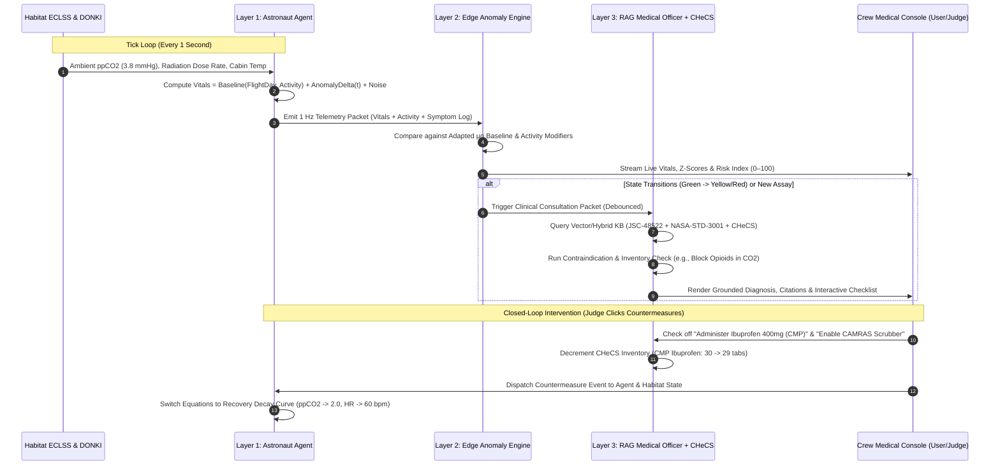

# Deep-Dive System Mechanics: How the 3-Layer Autonomous Medical Architecture Works

> [!IMPORTANT]
> **The Winning Engineering Differentiator: A Closed-Loop System**  
> Most hackathon projects are **one-way** (`Simulate Bad Numbers → Show Red Alert → Print Text`).  
> Our system is a **Closed-Loop Autonomous Control System**: when the Crew Medical Officer executes the RAG-recommended countermeasures (e.g., activating backup $\text{CO}_2$ scrubbers, initiating LBNP, or administering a CHeCS medication), **those actions feed back into the Layer 1 mathematical equations**, stabilizing the astronaut's vitals in real time and updating the onboard medical kit inventory.

---

## 1. The Complete Closed-Loop Sequence

---

## 2. Layer 1 Mechanics: How Astronaut Digital-Twin Agents Work

Instead of generating random numbers, each Astronaut Agent is an independent **stateful mathematical object** updated every $1\text{ second}$ ($\Delta t_{\text{sim}}$ can be $1\times$ real-time or accelerated $60\times$ so judges can watch a 2-hour physiological crisis unfold in 2 minutes!).

### 2.1 The 4 Internal States of an Astronaut Agent
1. **Adaptation State (`flight_day` $d$):**
   - Tracks how long the astronaut has been in microgravity.
   - Example: If $d > 75$, resting Core Body Temperature automatically shifts up by $+0.8\text{ to }+1.0^\circ\text{C}$ ($37.4\text{–}38.0^\circ\text{C}$, "Space Fever") and resting HR shifts down to $52\text{–}68\text{ bpm}$.
2. **Activity Context State (`activity`):**
   - `SLEEP` | `IVA_REST` | `ARED_EXERCISE` | `EVA_SPACEWALK`
   - Dictates both the expected physiological baseline *and* how much $\text{O}_2$ the astronaut consumes and $\text{CO}_2$ they exhale into the cabin!
3. **Coupled Habitat Environment State (`habitat`):**
   - All crew agents share the spacecraft cabin air.
   - If 2 astronauts run `ARED_EXERCISE` at $75\%\text{ VO}_{2\max}$ ($49.85 \times 10^{-4}\text{ kg/min }\text{CO}_2$ each — $7\times$ resting output) while the CDRA zeolite scrubber is degraded, cabin $pp\text{CO}_2$ automatically climbs past the $3.0\text{ mmHg}$ `NASA-STD-3001 [V2 6004]` limit, affecting **every** astronaut in the habitat!
4. **Active Anomaly & Recovery State (`scenario` + `countermeasures_applied`):**
   - Applies the exact differential/algebraic equations from [`01-nasa-space-medicine-research.md`](./01-nasa-space-medicine-research.md) as a function of elapsed scenario time $t$.
   - **Time-Compression Slider (`1x`, `10x`, `60x`):** Since real hypercapnia or radiation lymphopenia develops over minutes to hours, adding a **`Simulation Speed: 30x`** toggle on the dashboard lets judges watch multi-hour equations evolve smoothly over 10–15 seconds.

### 2.2 General Vitals Synthesis Formula (Per Tick)
For any vital sign $V \in \{HR, SBP, DBP, \text{SpO}_2, HRV, CBT, RR\}$ at simulation time $t$:

$$V(t) = V_{\mu g\text{-base}}(d, \text{activity}) + \Delta V_{\text{scenario}}(t) - \Delta V_{\text{recovery}}(t - t_{\text{treated}}) + \mathcal{N}(0, \sigma_V^2)$$

Where $\mathcal{N}(0, \sigma_V^2)$ adds subtle physiological beat-to-beat variability (or real PhysioNet waveform templates) so the charts look like authentic ICU/telemetry monitors.

---

## 3. Layer 2 Mechanics: How the Context-Aware Edge Engine Prevents False Alarms

A naive monitoring app uses fixed `if (HR > 100)` rules. In space, that fails completely. Layer 2 acts as an intelligent **Context Filter + Multi-Parametric Correlator** before waking up the RAG AI.

### 3.1 The "Earth vs. Space" Diagnostic Matrix (Why Layer 2 is Smart)

| Incoming Telemetry | What a Naive Earth App Does | What Our Layer 2 Space Engine Does |
| :--- | :--- | :--- |
| **`CBT = 37.9 °C`** during `IVA_REST` on Flight Day 90 | **False Positive:** Flags "Fever / Infection" ($>37.2^\circ\text{C}$ Earth norm). | **Nominal (Green):** Recognizes adapted $\mu g$ "Space Fever" baseline ($37.4\text{–}38.0^\circ\text{C}$ after FD 75). |
| **`HR = 158 bpm`, `SBP = 178 mmHg`, `CBT = 39.3 °C`** during `ARED_EXERCISE` | **False Positive:** Flags "Severe Tachycardia & Hypertensive Crisis." | **Nominal (Green):** Verifies `activity == ARED_EXERCISE` ($75\%\text{ VO}_{2\max}$) where $HR \le 165$, $SBP \le 185$, and $CBT \le 39.6^\circ\text{C}$ are expected. |
| **`HR = 76 bpm`, `CBT = 37.7 °C`, `HRV = 16 ms`** during `SLEEP` | **False Negative:** Misses it because $76\text{ bpm}$ is normal on Earth. | **Warning (Yellow):** Flags **Nocturnal Autonomic Stress / Circadian Desynchrony** (Sleep $\mu g$ HR should be $42\text{–}55\text{ bpm}$ and CBT should dip to $36.8\text{–}37.3^\circ\text{C}$). |
| **`HR = 88 bpm`, `RR = 20 bpm`**, plus **`cabin_ppCO2 = 3.6 mmHg`** | Flags generic "Mild Elevated Heart Rate." | **Correlated Alert (Yellow/Red):** Combines ECLSS sensor (`[V2 6004]` breach $>3.0\text{ mmHg}$) + cardiorespiratory drift $\rightarrow$ Tags **Environmental Hypercapnia**. |

### 3.2 Composite Astronaut Readiness & Risk Score ($0\text{–}100$)
Layer 2 calculates a continuous **Risk Score** every second using weighted Z-scores across 4 domains:
1. **Hemodynamic Score ($30\%$):** $HR$, $SBP$, $DBP$, Pulse Pressure ($SBP - DBP$).
2. **Respiratory & Thermal Score ($25\%$):** $RR$, $\text{SpO}_2$, $CBT$ margin to $40.2^\circ\text{C}$.
3. **Autonomic & Neuro-Ocular Score ($20\%$):** $HRV_{\text{RMSSD}}$, OCT RNFL thickness, Cognitive Throughput.
4. **Environmental & Radiation Hazard Score ($25\%$):** Cabin/Suit $pp\text{CO}_2$, Cumulative BFO dose ($\text{mGy-Eq}$), active NASA DONKI SEP/FLR alerts.

### 3.3 Event Debouncing (Protecting Layer 3 from Spam)
Layer 2 runs at `1 Hz` (zero cost, `<1 ms` latency). It **only** dispatches a request to Layer 3 (the RAG AI) when:
- A crewmember's Alert State escalates (`NOMINAL` $\rightarrow$ `WARNING` or `WARNING` $\rightarrow$ `CRITICAL`), **OR**
- A specialized point-of-care diagnostic is submitted (`OCT Scan`, `i-STAT Blood Gas`, `IJV Ultrasound`, `C2M2 CBC`), **OR**
- The NASA DONKI API reports a new `FLR` / `SEP` solar storm while a crewmember is scheduled for or performing an EVA.

---

## 4. Layer 3 Mechanics: How the Autonomous RAG Medical Officer Works

When Layer 2 triggers an alert during a **20-minute Mars communication delay** (or total solar conjunction blackout), Layer 3 acts as the onboard **Level V Autonomous Physician**.

### 4.1 What Is Stored in the RAG Knowledge Base?
Instead of dumping raw 500-page PDFs that confuse retrieval, we structure our RAG corpus into **high-precision, metadata-tagged clinical chunks** (~300–500 tokens each):
- **Collection 1: `nasa_std_3001_thresholds`** — Exact physiological, atmospheric (`[V2 6004]`), and radiation (`[V1 4030]`) limits.
- **Collection 2: `jsc_48522_medical_checklists`** — Step-by-step diagnostic and stabilization procedures for all 8 spaceflight scenarios (e.g., LBNP protocol, ITV resuscitation, urethral catheterization, ALARA storm shelter).
- **Collection 3: `checs_2023_formulary_and_packs`** — Every medication, dosage, pack location (`CMP`, `OMP`, `TIMP`, `EMTP`, `Vascular Contingency Pack`), required hardware (`RSP`, `MDP`, `ISP`, `CMRS`), and **strict spaceflight contraindications**.

### 4.2 "Unbreakable Demo" Dual-Mode Architecture (Online LLM + Offline Fallback)
- **Mode A (Live AI / Local Ollama or Gemini API):** Dynamically generates natural-language clinical reasoning and answers free-text follow-up questions from the judges using the retrieved RAG chunks.
- **Mode B (Zero-Latency Offline Protocol Engine):** If API keys rate-limit or Wi-Fi drops during judging, the RAG retriever still runs 100% locally and populates the exact structured diagnosis, citations, CHeCS drug cards, and interactive checklist in `<50 ms`. Your demo can **never** crash.

---

## 5. Deep-Space Asynchronous Earth Sync ("Store-and-Forward Telemetry Packet")

What happens *after* the autonomous system stabilizes the astronaut?
- Because Earth is 20 minutes away one-way, the system packages a **Compressed Clinical Telemetry & Intervention Log** (containing the onset waveform, Layer 2 trigger, RAG citations used, CHeCS drugs administered, and post-treatment recovery curve) into a **Store-and-Forward Downlink Packet** queued for the Ground Flight Surgeon team on Earth.
