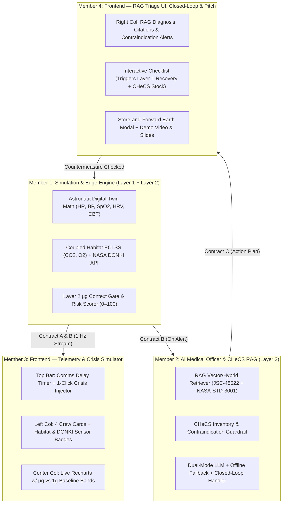

# 👥 4-Member Team Work Breakdown & Parallel Execution Plan

This document splits the entire **A.R.E.S. Med** project across **4 Software Engineering students** so that:
1. **Nobody blocks anyone else** (thanks to the locked-in JSON Data Contracts).
2. **Zero Git merge conflicts** (every member owns separate files and folders).
3. **Every layer of the 3-Layer Architecture + the Pitch** has a dedicated owner.

---

## 🗺️ High-Level Ownership Map

---

## 👨‍💻 Detailed Breakdown by Team Member

### Member 1: Astronaut Agents, Habitat Physics & Edge Anomaly Engine (Layer 1 & Layer 2)
* **Role Title:** *Simulation & Telemetry Systems Engineer*
* **Files Owned:**
  - `backend/layer1_agents/astronaut_agent.py`
  - `backend/layer1_agents/habitat_eclss.py`
  - `backend/layer2_edge/anomaly_detector.py`
  - `backend/layer2_edge/donki_client.py`
* **What You Build:**
  1. **The 4 Astronaut Digital-Twin Agents (Layer 1):**
     - A Python class that runs a `1 Hz` loop (with a `1x` to `30x` time-multiplier).
     - Generates `HR`, `SBP`, `DBP`, `SpO2`, `HRV`, `CBT`, and `RR` using the equations in [`data/rag_protocols_8_scenarios.json`](../data/rag_protocols_8_scenarios.json).
     - Implements **Recovery Mode**: when Member 4's UI sends a "Countermeasure Applied" signal, your equations smoothly decay the vitals back to the nominal microgravity baseline!
  2. **The Context-Aware Edge Detector (Layer 2):**
     - Reads [`data/nasa_baselines_and_thresholds.json`](../data/nasa_baselines_and_thresholds.json).
     - Checks the astronaut's `activity_state` (`SLEEP`, `IVA_REST`, `ARED_EXERCISE`, `EVA_SPACEWALK`) and `flight_day` (accounting for $+1^\circ\text{C}$ "Space Fever") to calculate the `0–100 Risk Score` and `GREEN / YELLOW / RED` alert state without false alarms.
  3. **Live NASA DONKI API Poller:**
     - Fetches real Solar Energetic Particle (`/DONKI/SEP`) and Solar Flare (`/DONKI/FLR`) events from `api.nasa.gov` (with a cached JSON backup in case venue Wi-Fi drops).

---

### Member 2: Autonomous RAG Medical Officer & CHeCS Inventory (Layer 3 + API Server)
* **Role Title:** *AI / RAG Clinical Decision Support Engineer*
* **Files Owned:**
  - `backend/layer3_rag/rag_engine.py`
  - `backend/layer3_rag/checs_inventory.py`
  - `backend/main.py`
* **What You Build:**
  1. **The NASA Space Medicine RAG Engine:**
     - Ingests [`data/rag_protocols_8_scenarios.json`](../data/rag_protocols_8_scenarios.json) and [`docs/01-nasa-space-medicine-research.md`](./01-nasa-space-medicine-research.md) into a lightweight local vector/hybrid index (e.g., `ChromaDB` / `FAISS` or structured hybrid search).
     - When Member 1's Layer 2 flags a `YELLOW` or `RED` anomaly, your RAG engine retrieves the matching `JSC-48522` checklist, `NASA-STD-3001` standard code, and `CHeCS` drug protocol.
  2. **The Contraindication Guardrail & CHeCS Subpack Tracker:**
     - Tracks onboard pill/ampoule counts across the 2023 ISS CHeCS packs (`CMP`, `OMP`, `TIMP`, `EMTP`, `VCP`).
     - Enforces hard safety rules (e.g., blocks opioids during Hypercapnia; blocks NSAIDs/Aspirin during Radiation Syndrome; flags `Protamine`/`PCC` reversal agents when prescribing `Enoxaparin`/`Apixaban`).
  3. **Dual-Mode Output (`Contract C`) + FastAPI Endpoints:**
     - Connects Gemini API (for dynamic clinical reasoning & judge Q&A) with a **100% offline deterministic fallback** so `Contract C` JSON is returned in `<50 ms` even with zero internet.

---

### Member 3: Frontend — Live Telemetry Grid, Baseline Bands & Crisis Simulator
* **Role Title:** *Frontend Telemetry & Data Visualization Engineer*
* **Files Owned:**
  - `frontend/src/components/HeaderBar.tsx`
  - `frontend/src/components/CrewDigitalTwinList.tsx`
  - `frontend/src/components/LiveTelemetryCharts.tsx`
* **What You Build:**
  1. **Top Mission Control Bar (`HeaderBar.tsx`):**
     - Displays `Mission Day: FD 84`, the pulsing `EARTH COMMS DELAY: 18m 42s — AUTONOMOUS LEVEL V` badge, the **Simulation Speed (`1x` / `30x`)** toggle, and the **1-Click Judge Crisis Injector Buttons** (`Nominal`, `CO2 Scrubbing Fault`, `Solar Particle Event`, `EVA Heat/DCS`, `SANS / IJV Clot`).
  2. **Left Column — Crew Digital Twins & Habitat Sensors (`CrewDigitalTwinList.tsx`):**
     - Shows the 4 astronaut cards with their current activity badge (`IVA_REST`, `ARED_EXERCISE`, `SLEEP`, `EVA`), live Risk Score (`0–100`), and color border (`Green`/`Yellow`/`Red`).
     - Shows the shared Habitat ECLSS card ($pp\text{CO}_2$, $pp\text{O}_2$, Cabin Temp, and NASA DONKI Radiation status).
  3. **Center Column — Space vs. Earth Live Charts (`LiveTelemetryCharts.tsx`):**
     - Uses `Recharts` to plot real-time streaming lines for the selected astronaut (`HR & HRV`, `SBP/DBP & SpO2`, `Core Temp & RR`).
     - **The Visual Hook:** Renders a shaded green **"Adapted $\mu g$ Safe Band"** and a dotted **"Earth $1g$ Norm"** line on every chart so judges immediately see how microgravity shifts physiology!

---

### Member 4: Frontend — Autonomous RAG Triage UI, Closed-Loop Checklist & Pitch Lead
* **Role Title:** *Clinical UI Engineer & Product Pitch Lead*
* **Files Owned:**
  - `frontend/src/components/AutonomousRagPanel.tsx`
  - `frontend/src/components/EarthDownlinkModal.tsx`
  - `frontend/src/types/contracts.ts`
  - Space Apps Project Submission Page, Slide Deck & 30s/2m Demo Video
* **What You Build:**
  1. **Right Column — Autonomous RAG Medical Officer Panel (`AutonomousRagPanel.tsx`):**
     - Renders `Contract C` from Member 2: the Diagnosis Title, `NASA-STD-3001` / `JSC-48522` citation pills, clinical reasoning summary, and the red **Strict Contraindication Warning Card**.
  2. **The Closed-Loop Interactive Checklist & CHeCS Inventory UI:**
     - Renders the step-by-step `JSC-48522` checklist with clickable checkboxes.
     - When a judge clicks a checkbox (e.g., `[x] Activate CAMRAS Backup Scrubber` or `[x] Administer Ibuprofen 400mg from CMP`), sends a `POST /api/countermeasure` call to Member 1 & Member 2 so the center charts visibly recover and the `CMP` pill counter decrements!
  3. **Store-and-Forward Earth Downlink Modal + Final Pitch:**
     - Builds the modal showing the compressed telemetry & treatment packet queued for Houston (`T-18m 42s`).
     - Leads the **2-Minute Live Pitch / 30-Second Video** using the working simulator while Members 1–3 wrap up edge cases in the final 8 hours.

---

## ⏱️ How the 4 Members Sync During the 48 Hours

| Hackathon Hour | Member 1 (Sim & Edge) | Member 2 (RAG & API) | Member 3 (Charts & Grid) | Member 4 (RAG UI & Pitch) |
| :--- | :--- | :--- | :--- | :--- |
| **Hours 0–3** | Scaffold Python agent loop returning mock `Contract A/B` | Scaffold FastAPI server returning mock `Contract C` | Scaffold Vite + Tailwind layout with mock `Contract A/B` | Build TypeScript interfaces (`contracts.ts`) + Right Panel UI |
| **Hour 4 (Sync #1)** | **Connect Frontend & Backend on localhost using the exact JSON Contracts!** | | | |
| **Hours 4–18** | Code the math equations for the Showcase Scenarios + DONKI API | Ingest `rag_protocols_8_scenarios.json` + CHeCS stock & contraindications | Build `Recharts` live graphs with $\mu g$ vs $1g$ shaded bands + Crisis Buttons | Build interactive Closed-Loop Checklist + Contraindication Cards |
| **Hour 18 (Sync #2)** | **End-to-End Closed-Loop Test:** Click "Inject CO2 Crisis" $\rightarrow$ Charts Spike $\rightarrow$ RAG Diagnoses $\rightarrow$ Click Checklist $\rightarrow$ Vitals Recover! | | | |
| **Hours 18–34** | Add remaining scenarios + `30x` speed multiplier polish | Add Gemini API live Q&A + test 100% offline fallback mode | Polish dark-mode NASA animations, alert banners, and sound/visual cues | Build Earth Downlink Modal + draft Space Apps submission text & slides |
| **Hours 34–48** | Code freeze, bug fixes, and backup video recording | Code freeze, API stress test, and offline verification | UI polish on projector/1080p screen resolution | Record 30s/2m demo video, finalize slides, and submit early! |
