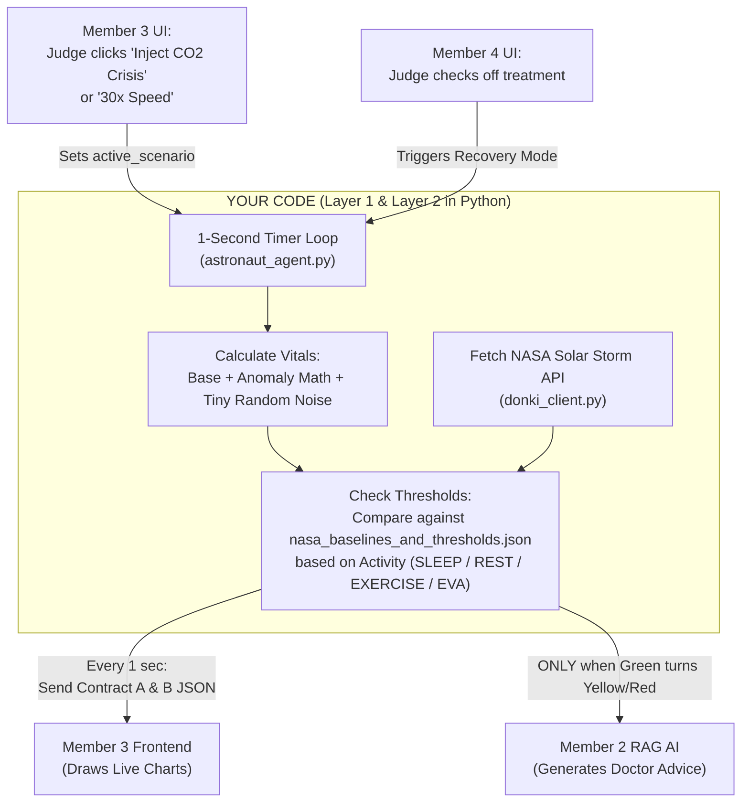

# 🧑‍💻 Member 1 Personal Playbook: Astronaut Simulator & Smart Alarm

**Your Role in Plain English:** You build the **heartbeat of the backend**. Every 1 second, your Python code generates realistic health numbers for 4 astronauts and checks if their numbers are safe or dangerous in zero-gravity.

> 💡 **What you do NOT need to worry about:** You do **not** touch the Frontend UI, and you do **not** build the RAG AI or LLM prompts. You just generate the astronaut numbers and check if they cross the thresholds in [`data/nasa_baselines_and_thresholds.json`](../data/nasa_baselines_and_thresholds.json)!

---

## 1. Visual Diagram of Your Exact Job



---

## 2. How Your Code Works (Step-by-Step)

### Part A: The 4 Astronaut Objects (`layer1_agents/astronaut_agent.py`)
You create 4 astronauts in Python:
1. **CDR Maya Lin** (`activity_state = "IVA_REST"`) — *Our main demo astronaut!*
2. **PLT Alex Vance** (`activity_state = "ARED_EXERCISE"`) — *Shows high HR (`155 bpm`) is still GREEN during exercise!*
3. **MS1 Dr. Elena Rossi** (`activity_state = "SLEEP"`)
4. **MS2 Kenji Sato** (`activity_state = "EVA_SPACEWALK"`)

Every 1 second:
- If `active_scenario == "NOMINAL"`, output normal microgravity numbers plus tiny random jitter (`random.uniform(-0.8, 0.8)`) so the graph looks alive.
- If the judge clicks a crisis button (like `SCENARIO_1_HYPERCAPNIA`), increment time `t` and apply the simple formula from [`data/rag_protocols_8_scenarios.json`](../data/rag_protocols_8_scenarios.json):
  ```python
  delta_co2 = max(0.0, cabin_ppCO2 - 2.0)
  hr_bpm = hr_base + 1.8 * delta_co2
  sbp_mmHg = sbp_base + 1.4 * delta_co2
  rr_bpm = rr_base + 0.45 * delta_co2
  hrv_rmssd = hrv_base - 2.2 * delta_co2
  ```
- **When Member 4's UI sends a "Countermeasure Checked" signal:** Set `is_recovering = True` and smoothly move `cabin_ppCO2` and `hr_bpm` back to normal over 10 seconds!

### Part B: The Smart Alarm Filter (`layer2_edge/anomaly_detector.py`)
You load [`data/nasa_baselines_and_thresholds.json`](../data/nasa_baselines_and_thresholds.json) and check:
1. What is the astronaut's `activity_state`? (`SLEEP`, `IVA_REST`, `ARED_EXERCISE`, `EVA_SPACEWALK`)
2. Are their `hr_bpm`, `sbp_mmHg`, `spo2_pct`, `cbt_C`, or `cabin_ppCO2_mmHg` outside the safe range for that activity?
3. Calculate a `risk_score_0_100` (`0–30` = Green, `31–69` = Yellow Warning, `70–100` = Red Critical).
4. **Important:** Only set `"trigger_rag_consultation": true` when the alert state **changes** (e.g., from `NOMINAL_GREEN` to `WARNING_YELLOW`) so you don't spam Member 2's AI every second!

### Part C: NASA DONKI Solar Storm Fetcher (`layer2_edge/donki_client.py`)
A simple 20-line function that calls:
`https://api.nasa.gov/DONKI/SEP?api_key=YOUR_KEY` and `https://api.nasa.gov/DONKI/FLR?api_key=YOUR_KEY`
*(Tip: Save a sample JSON response in a local file so if the hackathon Wi-Fi dies, your function loads the backup file automatically!)*

---

## 3. Your Personal Checklist

### Before November 14 (2 Hours of Prep)
- [ ] Get a free NASA API key at [https://api.nasa.gov/](https://api.nasa.gov/).
- [ ] Open [`data/nasa_baselines_and_thresholds.json`](../data/nasa_baselines_and_thresholds.json) and [`data/rag_protocols_8_scenarios.json`](../data/rag_protocols_8_scenarios.json) to see the exact numbers and formulas already written for you.
- [ ] Practice writing a 30-line Python script that prints a fake astronaut JSON dictionary every 1 second.

### During the Hackathon (Nov 14–15)
- [ ] **Hours 0–3:** Return hardcoded `Contract A` and `Contract B` JSON so Member 3 can test their charts immediately.
- [ ] **Hours 4–16:** Code the math for the 4 main demo scenarios (`Hypercapnia CO2`, `Solar Radiation Storm`, `EVA Heat/DCS`, `SANS/IJV Clot`) + the `1x / 30x` speed multiplier.
- [ ] **Hours 16–24:** Add the **Recovery Loop** (when countermeasures are applied, numbers return to Green) and hook up the NASA DONKI API.
