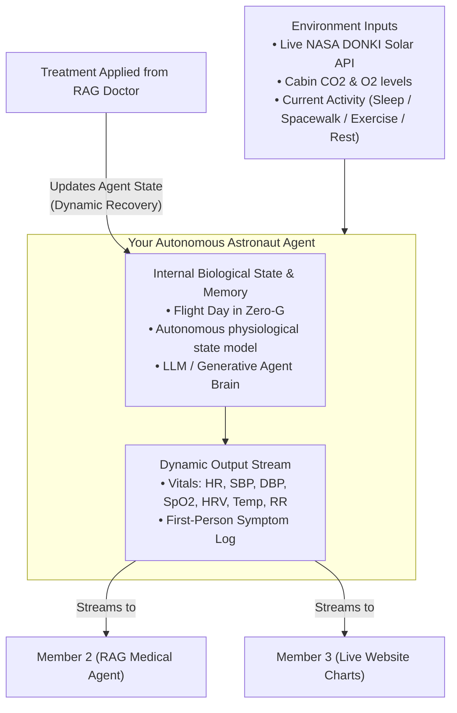

# 🧑‍💻 Member 1 Guide: Autonomous Astronaut Agent(s)

## 🎯 Your Goal
Build the **Astronaut Agent(s)** that simulate real astronauts on a deep-space mission and output **dynamic, non-hardcoded health telemetry and status logs**.

---

## 🤖 How Your Astronaut Agent Works



---

## 🛠️ What You Build (3 Key Parts)

### 1. Dynamic (Non-Hardcoded) Physiology & State Engine
Instead of fixed `if/else` numbers, each Astronaut Agent maintains a continuous **biological state** that evolves based on:
- **Real Physiological Waveforms & Baselines:** Seeded from **PhysioNet** datasets and the microgravity adaptation ranges in [`data/nasa_baselines_and_thresholds.json`](../data/nasa_baselines_and_thresholds.json).
- **Activity & Environment Coupling:** The agent reacts naturally to what it is doing (`Sleeping`, `Spacewalk EVA`, `ARED Exercise`, `Habitat Rest`) and external stressors (like real solar flare data fetched from NASA's `https://api.nasa.gov/DONKI/` API or cabin $\text{CO}_2$ buildup).

### 2. Agent Brain & First-Person Symptom Logs
Using an LLM Agent (e.g., Gemini API / LangChain / CrewAI with structured JSON output), the Astronaut Agent interprets its own internal physiological shifts and emits realistic first-person updates, such as:
> *"Working at the science glovebox for 90 minutes. Developing a throbbing frontal headache and finding it harder to focus on the screen."*

### 3. Dynamic Reaction to Treatment
When Member 2's RAG Medical Agent (or the user on the dashboard) applies a treatment—such as turning on backup $\text{CO}_2$ scrubbers, moving to the radiation storm shelter, or administering a medication—your Astronaut Agent receives that event in its memory and **dynamically stabilizes its vitals and symptom logs**.

---

## 📦 JSON Format Your Agent Outputs
Every tick/update, your agent outputs a clean JSON object that Member 2 and Member 3 consume:
```json
{
  "astronaut_id": "AST-01",
  "name": "CDR Maya Lin",
  "mission_day": 84,
  "activity": "IVA_REST",
  "environment": {
    "cabin_co2_mmHg": 3.8,
    "radiation_mSv_hr": 0.05,
    "solar_storm_active": false
  },
  "vitals": {
    "heart_rate_bpm": 88.4,
    "systolic_bp_mmHg": 125.1,
    "diastolic_bp_mmHg": 76.3,
    "spo2_pct": 97.2,
    "hrv_ms": 21.0,
    "body_temp_C": 37.9,
    "respiration_rate_bpm": 19.5
  },
  "agent_status_log": "Developing a throbbing frontal headache and mild facial flushing near the glovebox."
}
```

---

## ✅ Pre-Hackathon Prep (Before Nov 14)
- [ ] Get a free NASA API key at [https://api.nasa.gov/](https://api.nasa.gov/) to pull live solar weather into your agent's environment.
- [ ] Review [`data/nasa_baselines_and_thresholds.json`](../data/nasa_baselines_and_thresholds.json) to see how zero-gravity shifts normal human vitals.
- [ ] Test a small Python agent script that updates a state object and outputs the JSON structure above.
