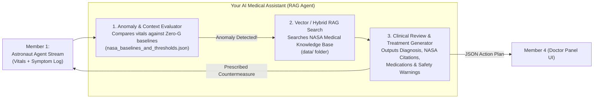

# 🧠 Member 2 Guide: AI Medical Assistant (RAG Agent)

## 🎯 Your Goal
Build the **Autonomous Medical Officer (RAG Agent)** that monitors Member 1's Astronaut Agent, detects anomalies, retrieves the official NASA medical protocol from our knowledge base, and outputs a clinical review and action plan.

---

## 🤖 How Your RAG Medical Agent Works



---

## 🛠️ What You Build (3 Key Parts)

### 1. Context-Aware Anomaly Watcher
Your agent continuously inspects the JSON stream coming from Member 1's Astronaut Agent against [`data/nasa_baselines_and_thresholds.json`](../data/nasa_baselines_and_thresholds.json):
- It checks the astronaut's **Activity Context** (`SLEEP`, `IVA_REST`, `ARED_EXERCISE`, `EVA_SPACEWALK`). For example, a heart rate of `150 bpm` during `ARED_EXERCISE` is normal, whereas `88 bpm` during `IVA_REST` with rising cabin $\text{CO}_2$ triggers a RAG medical consultation!

### 2. NASA Space Medicine RAG Pipeline
You index our two curated files in [`data/`](../data/):
- [`data/nasa_space_medicine_research.md`](../data/nasa_space_medicine_research.md)
- [`data/rag_protocols_8_scenarios.json`](../data/rag_protocols_8_scenarios.json)

Using a vector database (like `ChromaDB` or `FAISS`) + embeddings, when an anomaly happens, your agent retrieves the exact **NASA Standard (`NASA-STD-3001`)**, **ISS Medical Checklist (`JSC-48522`)**, and **Spacecraft Med-Kit (`CHeCS`)** rules.

### 3. Clinical Review & Safety Output
Your RAG Agent passes the retrieved NASA protocol + the Astronaut Agent's vitals and symptom log to the LLM to return a structured JSON diagnosis:
```json
{
  "alert_level": "WARNING",
  "diagnosis": "Acute Cabin Hypercapnia (CO2 Toxicity)",
  "nasa_citations": [
    "NASA-STD-3001 Vol 2 [V2 6004]",
    "ISS Medical Checklist JSC-48522"
  ],
  "clinical_review": "Astronaut CDR Lin shows elevated resting HR (88.4 bpm vs 52-68 bpm zero-G baseline), suppressed HRV (21 ms), and tachypnea correlated with elevated cabin CO2 (3.8 mmHg) and frontal headache.",
  "medication": "Ibuprofen 400 mg PO from Convenience Medications Pack (CMP)",
  "safety_warning": "CONTRAINDICATION: Do NOT administer opioid painkillers — suppresses respiratory drive and worsens CO2 retention.",
  "recommended_actions": [
    "Relocate astronaut to high-ventilation module and activate portable fan",
    "Switch ECLSS to backup CAMRAS amine scrubber",
    "Administer Ibuprofen 400 mg PO from CMP",
    "Suspend high-intensity exercise until CO2 < 2.5 mmHg"
  ]
}
```

---

## ✅ Pre-Hackathon Prep (Before Nov 14)
- [ ] Explore [`data/rag_protocols_8_scenarios.json`](../data/rag_protocols_8_scenarios.json) and [`data/nasa_space_medicine_research.md`](../data/nasa_space_medicine_research.md).
- [ ] Practice loading those files into a basic Python RAG script (`ChromaDB` / `FAISS` / `LangChain` or `google-genai` SDK) and returning structured JSON via `FastAPI`.
