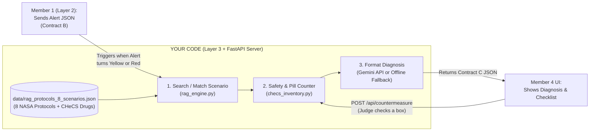

# 🧠 Member 2 Personal Playbook: AI Space Doctor (RAG) & Med-Kit Manager

**Your Role in Plain English:** You build the **AI Brain (`Layer 3`) and the FastAPI Server**. When Member 1's code detects that an astronaut is in danger, your code looks up the official NASA medical treatment from our JSON database and returns a structured diagnosis, medication warning, and 4-step checklist.

> 💡 **What you do NOT need to worry about:** You do **not** need to calculate heart rate equations (Member 1 does that) or build React charts (Member 3 does that). And your entire medical database is **already written for you** in [`data/rag_protocols_8_scenarios.json`](../data/rag_protocols_8_scenarios.json)!

---

## 1. Visual Diagram of Your Exact Job



---

## 2. How Your Code Works (Step-by-Step)

### Part A: The RAG Retriever (`layer3_rag/rag_engine.py`)
1. Load [`data/rag_protocols_8_scenarios.json`](../data/rag_protocols_8_scenarios.json) (which has all 8 scenarios, NASA citations, CHeCS drugs, contraindications, and checklists).
2. You can index those 8 documents + chunks from [`docs/01-nasa-space-medicine-research.md`](../docs/01-nasa-space-medicine-research.md) using a lightweight vector search (like `ChromaDB`, `FAISS`, or `scikit-learn` TF-IDF/cosine similarity) **plus** metadata matching on the breached parameters.
3. **Why Hybrid/Fallback is Your Superpower:**
   - **If Internet/API is working:** Pass the retrieved NASA protocol chunk + the astronaut's live vitals into the **Gemini API** to generate a tailored `clinical_reasoning` paragraph inside `Contract C`.
   - **If Hackathon Wi-Fi dies (or Offline Mode toggle is ON):** Your code skips the internet call and builds `Contract C` directly from the retrieved JSON fields in `<10 milliseconds`! Your demo will **never** fail in front of judges.

### Part B: The CHeCS Med-Kit Inventory & Safety Guardrail (`layer3_rag/checs_inventory.py`)
In space, astronauts have a limited medical kit (**CHeCS** divided into `CMP`, `OMP`, `TIMP`, `EMTP`, and `Vascular Contingency Pack`).
Your code keeps a simple dictionary of stock counts, for example:
```python
checs_stock = {
    "Ibuprofen 400mg (CMP)": 24,
    "Acetaminophen 325mg (CMP)": 30,
    "Ondansetron 4mg ODT (OMP)": 16,
    "Enoxaparin Syringe (VCP)": 10,
    "Protamine Reversal (VCP)": 4
}
```
When the judge clicks a checklist item on Member 4's screen (e.g., *"Administer Ibuprofen 400mg"*), your endpoint subtracts `1` from `checs_stock` and notifies Member 1's simulator to start healing the astronaut!

### Part C: The FastAPI Endpoints (`backend/main.py`)
You expose **4 simple routes** so Members 3 & 4 can talk to the backend:
1. `GET /api/state` (or WebSocket `/ws/telemetry`) $\rightarrow$ Returns Member 1's `Contract A` & `Contract B` every second.
2. `POST /api/scenario/{scenario_id}` $\rightarrow$ Lets Member 3's buttons inject a crisis into Member 1's simulator.
3. `POST /api/rag/consult` $\rightarrow$ Returns your `Contract C` AI Doctor Action Plan.
4. `POST /api/countermeasure` $\rightarrow$ Called when Member 4's checklist is clicked; decrements `checs_stock` and triggers Member 1's recovery curve.

---

## 3. Your Personal Checklist

### Before November 14 (2 Hours of Prep)
- [ ] Read [`data/rag_protocols_8_scenarios.json`](../data/rag_protocols_8_scenarios.json) and `Contract C` in [`docs/02-master-engineering-plan.md`](../docs/02-master-engineering-plan.md).
- [ ] Test a basic `FastAPI` server with CORS enabled (`CORSMiddleware`) on your laptop.
- [ ] Optional: Get a free Gemini API key to test generating a 2-sentence summary from a JSON chunk.

### During the Hackathon (Nov 14–15)
- [ ] **Hours 0–3:** Set up `backend/main.py` with the 4 endpoints returning sample `Contract A, B, C` JSON so Frontend (Members 3 & 4) can connect immediately at Hour 4.
- [ ] **Hours 4–16:** Build `rag_engine.py` and `checs_inventory.py` using [`data/rag_protocols_8_scenarios.json`](../data/rag_protocols_8_scenarios.json).
- [ ] **Hours 16–28:** Connect Gemini API with automatic offline fallback + add a free-text *"Ask AI Crew Medical Officer"* chat endpoint for bonus judge points!
