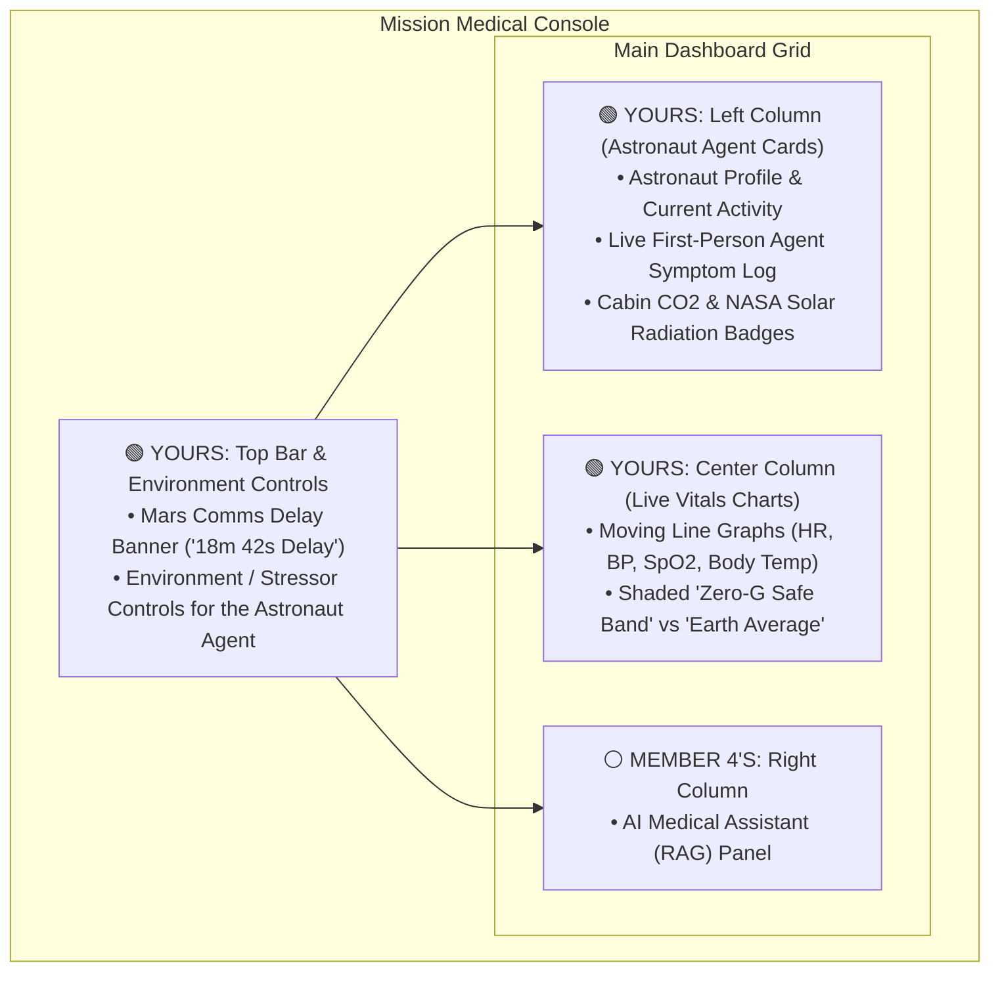

# 📈 Member 3 Guide: Frontend — Astronaut Agent View & Live Charts

## 🎯 Your Goal
Build the **Left and Center panels of the Web Dashboard** (React + Tailwind CSS + Recharts) that visualize **Member 1's Astronaut Agent(s)** in real time—showing their live vital sign charts, their first-person symptom feed, and environment controls.

---

## 🖥️ What You Own on the Screen

---

## 🛠️ What You Build (3 Key Components)

### 1. Astronaut Agent Profile & Live Log Feed (Left Column)
- Displays the crew of Astronaut Agents from Member 1's backend.
- Shows each agent's **Current Activity** (`IVA Rest`, `ARED Exercise`, `Spacewalk EVA`, `Sleeping`), current vitals summary, and status badge (`Nominal`, `Warning`, `Critical`).
- **Live Agent Voice Feed:** Displays the first-person status messages generated by Member 1's Astronaut Agent (e.g., *"Developing a throbbing frontal headache near the science glovebox..."*).

### 2. Real-Time Biometric Charts (Center Column)
- Uses `Recharts` to plot the live time-series data streaming from the selected Astronaut Agent:
  1. **Heart Rate (`bpm`) & HRV (`ms`)**
  2. **Systolic / Diastolic Blood Pressure (`mmHg`) & $\text{SpO}_2$ (`%`)**
  3. **Core Body Temperature (`°C`) & Respiration Rate (`bpm`)**
- **Visual Highlight:** Draw a shaded horizontal band showing the astronaut's **Zero-G Safe Range** alongside a dotted line for the **Earth Average** so judges can immediately see how spaceflight changes human baselines!

### 3. Environment & Stressor Controls (Top Bar)
- Let the user/judge change the spacecraft environment or inject a stressor into Member 1's Astronaut Agent (e.g., *Degrade $\text{CO}_2$ Scrubber*, *Simulate Solar Radiation Storm*, *EVA Suit Cooling Fault*) to watch the Astronaut Agent dynamically react!

---

## ✅ Pre-Hackathon Prep (Before Nov 14)
- [ ] Practice creating a dark-mode React + Tailwind dashboard layout with 3 columns.
- [ ] Practice building a live-updating `Recharts` `<LineChart>` using the sample JSON in [`MEMBER-1-GUIDE.md`](./MEMBER-1-GUIDE.md).
