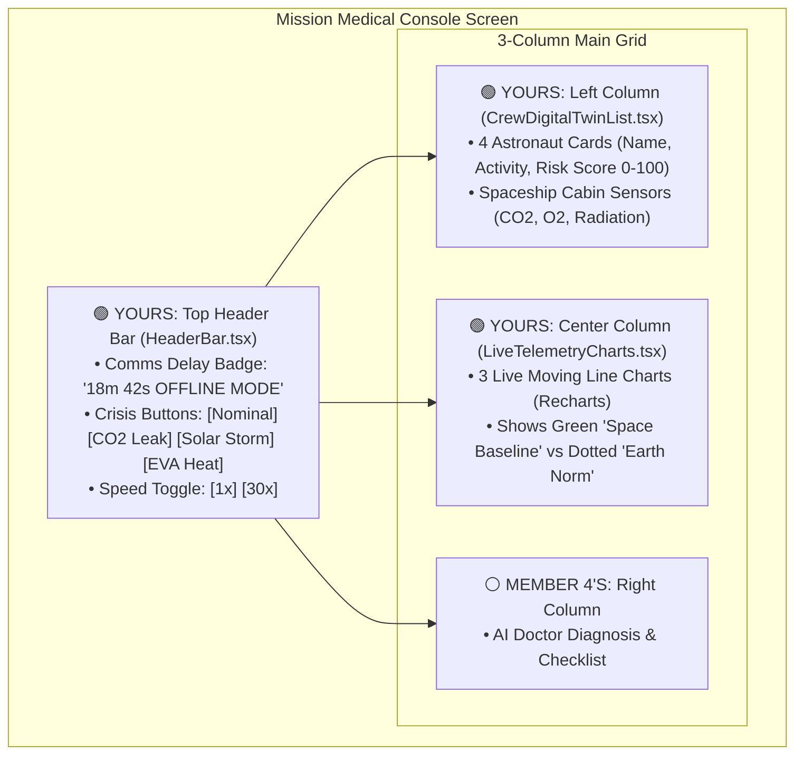

# 📈 Member 3 Personal Playbook: Frontend Telemetry, Crew Grid & Crisis Simulator

**Your Role in Plain English:** You build the **NASA Mission Control Telemetry UI** (Top Bar + Left Column + Center Live Graphs). You make the numbers from Member 1 look like a sleek, futuristic SpaceX/NASA medical console!

> 💡 **What you do NOT need to worry about:** You don't write any backend math or AI code, and you don't build the Right Column AI Doctor Checklist (Member 4 builds that). You can start building at Minute 1 using the sample JSON in [`docs/02-master-engineering-plan.md`](../docs/02-master-engineering-plan.md)!

---

## 1. Visual Diagram of What You Own on Screen

---

## 2. The 3 Components You Build

### Component 1: `HeaderBar.tsx` (The Judge's Remote Control)
At the top of the screen, you put:
1. **The Mars Comms Delay Banner:** A glowing badge that says `EARTH COMMS DELAY: 18m 42s ONE-WAY | AUTONOMOUS LEVEL V ACTIVE`.
2. **The 1-Click Crisis Injector Buttons:** 5 buttons that call `POST /api/scenario/{id}`:
   - `[🟢 Nominal Orbit]`
   - `[💨 Scenario 1: Cabin CO2 Fault]`
   - `[☀️ Scenario 4: Solar Radiation Storm]`
   - `[🔥 Scenario 5: EVA Suit Heat / DCS]`
   - `[👁️ Scenario 2: SANS / IJV Clot]`
3. **Simulation Speed Toggle:** `[1x Real-Time]` | `[30x Fast-Forward]` so judges can watch a multi-hour condition happen in 10 seconds.

### Component 2: `CrewDigitalTwinList.tsx` (Left Column)
1. **4 Astronaut Cards:** Map over the crew list. Each card shows:
   - Astronaut Name (e.g., `CDR Maya Lin`)
   - Current Activity Badge (`IVA_REST`, `ARED_EXERCISE`, `SLEEP`, `EVA_SPACEWALK`)
   - Live Heart Rate & Risk Score (`0–100`) with a Green, Yellow, or Red glowing border.
2. **Habitat Environment Box:** Shows `Cabin ppCO2 (mmHg)`, `Cabin ppO2`, `Radiation Dose Rate`, and `NASA DONKI Solar Status`.

### Component 3: `LiveTelemetryCharts.tsx` (Center Column — Your Star Feature!)
Keep the last `30–60` seconds of telemetry in a React state array (`history`) and render **3 live `Recharts` line graphs** for the selected astronaut:
1. **Chart 1:** Heart Rate (`hr_bpm`) & Heart Rate Variability (`hrv_rmssd_ms`)
2. **Chart 2:** Blood Pressure (`sbp_mmHg` / `dbp_mmHg`) & Oxygen (`spo2_pct`)
3. **Chart 3:** Core Body Temp (`cbt_C`) & Respiration Rate (`rr_bpm`)

> 🌟 **The Secret Visual Trick Judges Love:** Use Recharts `<ReferenceArea>` to draw a **shaded green horizontal band** showing the astronaut's **Space ($\mu g$) Safe Range**, and a `<ReferenceLine>` showing the **Earth ($1g$) Average**. When an astronaut is exercising (`ARED_EXERCISE`), the green safe band automatically shifts up (`135–165 bpm`) so judges can *see* why our Layer 2 context filter is smart!

---

## 3. Your Personal Checklist

### Before November 14 (2 Hours of Prep)
- [ ] Look at the ASCII wireframe in [`docs/05-ui-ux-console-wireframe.md`](../docs/05-ui-ux-console-wireframe.md).
- [ ] Practice making one dark-mode `Recharts` `<LineChart>` with `<ReferenceArea>` in a test React + Tailwind app.

### During the Hackathon (Nov 14–15)
- [ ] **Hours 0–3:** Set up the Vite + React + Tailwind dark-mode 3-column grid and render `HeaderBar.tsx` and `CrewDigitalTwinList.tsx` using hardcoded `Contract A` JSON.
- [ ] **Hours 4–16:** Connect the `1 Hz` poll/WebSocket from Member 1 & 2's backend and build the 3 live streaming `Recharts` graphs with the Green Space Baseline bands.
- [ ] **Hours 16–30:** Add smooth visual transitions when a crisis button is clicked and when Recovery Mode turns the graphs back from Red/Yellow to Green!
