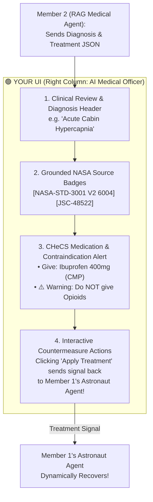

# 🩺 Member 4 Guide: Frontend — RAG Medical Assistant Panel & Pitch

## 🎯 Your Goal
Build the **Right Panel of the Web Dashboard** where **Member 2's RAG Medical Assistant** displays its clinical review, NASA citations, medication warnings, and interactive treatment buttons—and lead our **2-Minute Judge Pitch & Demo Video**.

---

## 🖥️ What You Own on the Screen

---

## 🛠️ What You Build (2 UI Parts + Pitch)

### 1. The RAG Medical Assistant Panel (Right Column)
Takes the JSON output from Member 2's RAG Agent and renders:
- **Clinical Analysis & Diagnosis:** Shows the AI Doctor's real-time review of why the Astronaut Agent's vitals and symptom logs are abnormal.
- **Direct NASA Quotations & Citations *(Crucial for the "Quotation" & "Validity" Rubric!)*:** Displays exact badges AND a direct verbatim quote from the retrieved NASA document (`NASA-STD-3001 [V2 6004]`, `ISS Medical Checklist JSC-48522`, `OCHMO-TB-004`) so judges immediately award full marks for **Quotation** and **Validity**.
- **"Meaningful Improvement" Comparison Badge:** Shows a 1-line comparison right on the alert card:
  - *Standard Earth Monitor:* ❌ False alarm / Requires Ground Doctor
  - *A.R.E.S. Med (Zero-G + Offline RAG):* ✅ Context-Adjusted + Autonomous Action
- **Spacecraft Med-Kit (`CHeCS`) & Safety Alert Box:** Highlights the exact medication pack to open and renders a high-visibility red warning for any spaceflight contraindications (e.g., *No opioids during high $\text{CO}_2$*).

### 2. Interactive "Apply Countermeasure" Feedback Loop
- Renders the recommended treatment steps as interactive action buttons/checkboxes.
- When clicked, sends a request back to Member 1's Astronaut Agent so the agent receives the treatment and **dynamically recovers on screen**!
- Optional bonus: A **"Ask AI Medical Officer"** chat input box at the bottom of your panel so judges can ask follow-up questions to Member 2's RAG Agent.

### 3. The 2-Minute Judge Pitch & Demo Video
While Members 1–3 finish polishing code on Day 2, you lead the slides and demo video:
1. **The Problem (0:00–0:25):** Deep-space missions have a 20-minute communication delay to Earth and unique zero-gravity physiology—astronauts need an autonomous onboard medical officer.
2. **The Astronaut Agent (0:25–0:55):** Show Member 1's Autonomous Astronaut Agent dynamically generating vitals and first-person status logs on Member 3's charts.
3. **The RAG Medical Officer (0:55–1:35):** Trigger an environmental stressor (like rising cabin $\text{CO}_2$ or a solar storm). Watch Member 2's RAG Agent detect the anomaly, retrieve official NASA medical protocols, and warn against dangerous medications.
4. **Closed-Loop Recovery (1:35–2:00):** Click **Apply Countermeasure** on your panel and watch the Astronaut Agent dynamically recover!

---

## ✅ Pre-Hackathon Prep (Before Nov 14)
- [ ] Review the sample JSON output in [`MEMBER-2-GUIDE.md`](./MEMBER-2-GUIDE.md) so you know the exact fields your panel will display.
- [ ] Practice building the Right Column UI card using React + Tailwind CSS.
- [ ] Test your screen-recording software (OBS / Loom / Windows Snipping Tool) for the hackathon demo video.
