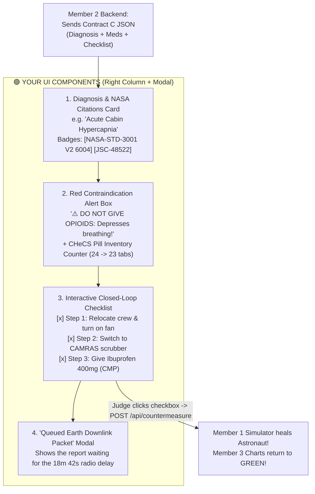

# 🩺 Member 4 Personal Playbook: AI Doctor Triage UI, Closed-Loop Checklist & Pitch Lead

**Your Role in Plain English:** You build the **Right Column of the UI (`AutonomousRagPanel.tsx`)**—where the AI Space Doctor explains the diagnosis, warns about dangerous medications, and gives a clickable **To-Do Checklist** that actually heals the astronaut when clicked! You also lead our **2-Minute Judge Pitch & Video**.

> 💡 **What you do NOT need to worry about:** You don't write backend math or RAG code, and you don't build the Recharts line graphs (Member 3 does that). You take `Contract C` JSON from Member 2 and turn it into an interactive clinical dashboard!

---

## 1. Visual Diagram of What You Own

---

## 2. The 3 Things You Build + The Pitch

### Part 1: Shared TypeScript Types (`frontend/src/types/contracts.ts`)
In the first 30 minutes of the hackathon, copy `Contract A`, `Contract B`, and `Contract C` from [`docs/02-master-engineering-plan.md`](../docs/02-master-engineering-plan.md) into a TypeScript interface file (`contracts.ts`) so both you and Member 3 have autocomplete!

### Part 2: `AutonomousRagPanel.tsx` (The Right Column)
When the astronaut is **Green (Nominal)**, show a calm green card:
- *"Crew Medical Officer AI: Standby — All vitals within adapted microgravity ($\mu g$) baselines."*
When an anomaly triggers (**Yellow** or **Red**), display `Contract C`:
1. **Diagnosis Header & Confidence Badge:** e.g., `Acute Cabin Hypercapnia (94% Match)`
2. **Official NASA Standard Badges:** Render clickable-looking pills for every item in `nasa_citations` (`NASA-STD-3001 [V2 6004]`, `JSC-48522 Sec 4.2`). *Judges grade heavily on seeing official NASA sources on screen!*
3. **CHeCS Medication & Contraindication Box:**
   - Show the recommended drug + which NASA medical pack it's in (`Convenience Medications Pack - CMP`) + how many pills are left in stock.
   - Show a bright red warning box for `contraindication_warning` (e.g., *"STRICT CONTRAINDICATION: Do NOT administer opioids"*).
4. **The Interactive Closed-Loop Checklist:**
   - Render each step in `autonomous_checklist` as a big, satisfying checkbox button.
   - When clicked, call `POST /api/countermeasure`. Once checkboxes are ticked, show a glowing badge: `✅ COUNTERMEASURES ACTIVE — ASTRONAUT STABILIZING`.

### Part 3: `EarthDownlinkModal.tsx` (Store-and-Forward Report)
A simple popup modal triggered by a button in the header (`[📡 View Queued Earth Packet (T-18m 42s)]`) that displays a clean summary of the incident ready to transmit to Flight Surgeons in Houston once the 20-minute radio delay passes.

### Part 4: The 2-Minute Judge Pitch & 30-Second Video Storyboard
In a hackathon, **50% of winning is the presentation**. While Members 1–3 fix final bugs on Day 2, you lead recording the demo following this exact 4-part story:
1. **0:00–0:25 (The Problem):** *"On the ISS, if an astronaut gets sick, they video-call Earth in real time. On a Mars mission, radio takes 20 minutes each way—and zero-gravity changes human body temperature and blood pressure so Earth medical apps give false alarms."*
2. **0:25–0:55 (Layer 1 & 2 Demo):** *"Meet A.R.E.S. Med. On the left, our Digital-Twin Astronaut Agents stream live vitals. Notice Pilot Vance has a heart rate of 154 bpm—our Context-Aware Edge Engine keeps him GREEN because he is on the ARED exercise machine."*
3. **0:55–1:35 (Crisis & RAG Demo):** *"Now we inject a Cabin CO2 Scrubber Fault on Commander Lin. Her heart rate rises to 88 bpm at rest. While Earth is 18 minutes away, our RAG Medical Officer retrieves NASA Standard 3001 and JSC-48522, prescribes Ibuprofen from the CHeCS kit, and warns NEVER to give opioids."*
4. **1:35–2:00 (Closed-Loop Recovery):** *"As we check off the countermeasures on screen, watch the closed loop in action: backup scrubbers engage, CHeCS inventory updates, and Commander Lin's vitals stabilize back into her microgravity safe band."*

---

## 3. Your Personal Checklist

### Before November 14 (2 Hours of Prep)
- [ ] Read `Contract C` in [`docs/02-master-engineering-plan.md`](../docs/02-master-engineering-plan.md) so you know the exact JSON fields you will display.
- [ ] Practice the 2-minute pitch script above out loud once or twice.
- [ ] Make sure you have screen-recording software (like OBS or Windows Snipping Tool / Loom) ready on your laptop for Day 2.

### During the Hackathon (Nov 14–15)
- [ ] **Hours 0–3:** Create `contracts.ts` and build the static UI of `AutonomousRagPanel.tsx` using the sample `Contract C` JSON.
- [ ] **Hours 4–18:** Connect `AutonomousRagPanel.tsx` to Member 2's backend and wire up the interactive checkboxes (`POST /api/countermeasure`) + the CHeCS pill counter.
- [ ] **Hours 18–30:** Build `EarthDownlinkModal.tsx` and start setting up the NASA Space Apps submission page + slide deck.
- [ ] **Hours 30–48:** Record the demo video early (at least 6 hours before deadline!) and finalize the submission.
